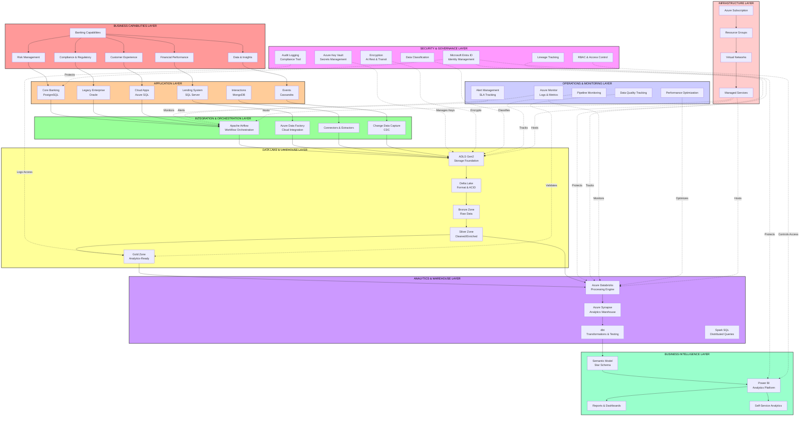

# ENTERPRISE ARCHITECTURE
## Enterprise Banking Data & Analytics Platform

**Document Version:** 1.0  
**Date:** 2026-09-01  
**Audience:** Enterprise Architects, Solution Architects, Technology Leadership

---

## TABLE OF CONTENTS

1. [Executive Summary](#executive-summary)
2. [Business Capability Model](#business-capability-model)
3. [Full Enterprise Architecture Diagram](#full-enterprise-architecture-diagram)
4. [Architecture Layers](#architecture-layers)
5. [Component Descriptions](#component-descriptions)
6. [Architectural Patterns](#architectural-patterns)
7. [Design Principles](#design-principles)

---

## EXECUTIVE SUMMARY

The platform integrates synthetic banking data from legacy, operational, cloud-native, document, and event stores into an Azure lakehouse. It converts governed Bronze data into conformed Silver data and purpose-specific Gold datasets, then exposes a curated warehouse/semantic layer for Power BI. The design supports fraud, credit, AML, Customer 360, and executive analytics without pretending that a portfolio deployment is a regulated bank.

### Core Architecture Model

**Data Flow Model:**
```
Operational Systems → Integration → Data Lake (Bronze/Silver/Gold) → Analytics Warehouse → BI Visualization
```

**Key Principles:**
- **Separation of concerns:** Extraction, transformation, storage, and analytics are distinct layers
- **Immutable raw data:** Bronze layer preserves exact source data
- **ELT default:** Load raw data, transform after
- **Incremental processing:** Process only new/changed data
- **Observable systems:** All components emit logs and metrics
- **Security by default:** Encryption, access control, audit logging built in

---

## BUSINESS CAPABILITY MODEL

### Banking Capabilities and Value Streams

| Capability | Business Driver | Related Use Cases | Key Metrics | Responsible Team |
| --- | --- | --- | --- | --- |
| **Risk Management** | Reduce financial losses | Fraud Detection, Credit Risk, Portfolio Monitoring | Fraud Detection %, False Positive %, Model Accuracy | Risk Officers |
| **Compliance & Regulatory** | Meet regulatory requirements | AML/KYC Monitoring, Suspicious Transactions, Regulatory Reports | Compliance %, Report Timeliness, Investigation Time | Compliance Officers |
| **Customer Experience** | Improve customer lifetime value | Customer 360, Segmentation, Personalization | CLV, Segmentation Accuracy, Cross-sell Conversion | Marketing & Product |
| **Financial Performance** | Maximize profitability | Executive Analytics, Product Profitability, Channel Analysis | Revenue per Customer, Cost per Transaction, Efficiency Ratio | Finance & Executive |
| **Data & Analytics Platform** | Enable data-driven decisions | Self-service Analytics, Advanced Analytics, BI | Report Availability, Data Freshness, User Adoption | Data Team |

### Capability-to-Application Mapping

| Business Capability | Source Applications | Data Sources | Integration | Analytics Outcome |
| --- | --- | --- | --- | --- |
| **Customer & Account Servicing** | Core banking system; Digital app | PostgreSQL; Azure SQL | Daily full load | Customer/account history for 360 |
| **Payments & Fraud Prevention** | Transaction engine; Card processor | PostgreSQL; Cassandra events | Real-time + batch | Scored transaction facts; fraud alerts |
| **Lending & Credit Risk** | Loan origination; Branch system | SQL Server; PostgreSQL | Daily full load | Loan exposure; repayment facts; risk scores |
| **AML/KYC Monitoring** | Legacy ledger; Interaction log | Oracle; MongoDB | Daily full load | Party/transaction/alert evidence |
| **Executive Performance** | All operational systems | All sources | Unified integration | Governed marts; executive KPIs |

---

## FULL ENTERPRISE ARCHITECTURE DIAGRAM

### Mermaid Diagram



### Diagram Explanation

The enterprise architecture follows a **bottom-up data flow pattern**:

1. **Infrastructure Layer (Foundation)**
   - Azure subscription, resource groups, networking, managed services
   - Provides the compute, storage, and network foundation

2. **Applications Layer (Sources)**
   - Operational systems capture transactional data
   - Six heterogeneous systems represent real enterprise complexity
   - Each optimized for operational use cases (OLTP)

3. **Integration & Orchestration Layer**
   - Airflow and ADF orchestrate data extraction
   - Connectors and CDC capture changes from each source
   - Clear separation between extraction and transformation

4. **Data Lake & Lakehouse Layer**
   - ADLS Gen2 provides scalable cloud storage
   - Delta Lake ensures ACID compliance and schema governance
   - Bronze → Silver → Gold progression enables incremental refinement

5. **Analytics & Warehouse Layer**
   - Databricks provides distributed compute for transformations
   - Azure Synapse acts as analytics warehouse
   - dbt enables testable, documented SQL transformations
   - Spark SQL enables ad-hoc queries

6. **Business Intelligence Layer**
   - Power BI creates visualizations
   - Semantic model (star schema) provides business semantics
   - Dashboards and self-service analytics serve business users

7. **Governance & Security (Cross-cutting)**
   - Identity & access management (Entra ID)
   - Encryption and key management (Key Vault)
   - Access control (RBAC)
   - Audit logging for compliance
   - Data classification and lineage

8. **Operations & Monitoring (Cross-cutting)**
   - Azure Monitor provides unified observability
   - Alert management tracks SLAs
   - Pipeline monitoring tracks execution
   - Data quality tracking validates transformations

---

## ARCHITECTURE LAYERS

### Layer 1: Business Capability Layer

**Purpose:** Map business needs to technology capabilities  
**Key Components:**
- Risk Management (Fraud, Credit, Portfolio)
- Compliance & Regulatory (AML/KYC)
- Customer Experience (360 view, personalization)
- Financial Performance (Profitability, efficiency)
- Data Platform (Self-service analytics)

**Responsibilities:**
- Define success metrics for each capability
- Align technology investments to business drivers
- Prioritize feature delivery
- Measure business impact

---

### Layer 2: Application & Service Layer

**Purpose:** Provide user interfaces and capture operational data  
**Key Components:**
- Core Banking Application
- Legacy Enterprise System
- Lending & Branch System
- Digital Banking Apps
- Interaction Capture Services
- Event Generation Services

**Responsibilities:**
- Accept customer transactions
- Maintain operational data
- Support mission-critical banking operations
- Generate events for analytics

**Characteristics:**
- Optimized for write performance (OLTP)
- High availability and reliability required
- Normalized database schemas
- Real-time transaction processing

---

### Layer 3: Data Ingestion & Integration

**Purpose:** Extract data from operational systems and transport to lake  
**Key Components:**
- **Apache Airflow:** Open-source orchestration
- **Azure Data Factory:** Azure-native integration
- **Database Connectors:** Extract from each source
- **Change Data Capture:** Capture incremental changes
- **API Extractors:** For web-based sources

**Responsibilities:**
- Extract data on schedule
- Validate schema and row counts
- Handle errors and retries
- Monitor extraction performance
- Alert on failures

**Design Patterns:**
- **Batch Frequency:** Daily for most sources; hourly for high-volume
- **Full vs. Incremental:** Full extract initially; incremental after baseline
- **Error Handling:** Retry 3 times before alerting
- **Deduplication:** At source when possible

---

### Layer 4: Data Lake & Lakehouse

**Purpose:** Store and organize all data in cloud-accessible format  
**Key Components:**
- **ADLS Gen2:** Azure cloud storage
- **Delta Lake:** ACID-compliant table format
- **Bronze Zone:** Raw data (exactly as extracted)
- **Silver Zone:** Cleaned, standardized, deduplicated
- **Gold Zone:** Analytics-ready, business-aligned

**Responsibilities:**
- Preserve raw data immutably
- Enforce schema at read time
- Manage data partitioning
- Track data quality
- Enable incremental processing

**Design Decisions:**
- **Storage Format:** Parquet files + Delta Lake wrapper
- **Partitioning:** By ingestion date, domain, and transaction date
- **Retention:** 2 years raw; 5 years processed
- **Access:** Read-only after initial load; immutable transforms create new datasets

---

### Layer 5: Analytics & Warehouse

**Purpose:** Transform data into analytics-ready format  
**Key Components:**
- **Azure Databricks:** Distributed computing platform
- **Azure Synapse:** Data warehouse with analytics
- **dbt:** SQL transformation framework
- **Spark SQL:** Distributed SQL engine
- **PySpark:** Python data processing

**Responsibilities:**
- Transform raw data into analytics-ready datasets
- Aggregate metrics and KPIs
- Enforce data quality rules
- Test transformations
- Manage schema evolution

**Processing Model:**
- **ELT Strategy:** Extract to Bronze, transform after
- **Micro-batching:** Daily or hourly batch processing
- **Incremental:** Process only new/changed data
- **Testing:** dbt test suite for all transformations

---

### Layer 6: Business Intelligence & Reporting

**Purpose:** Present insights to business users  
**Key Components:**
- **Power BI:** Analytics and visualization platform
- **Semantic Model:** Business metrics and dimensions
- **Reports:** Standard recurring reports
- **Dashboards:** Real-time KPI tracking
- **Self-Service Analytics:** Ad-hoc query capability

**Responsibilities:**
- Visualize data for stakeholders
- Maintain data semantics (star schema)
- Manage access control and row-level security
- Enable self-service analytics
- Deliver insights on schedule

**Design:**
- **Star Schema:** Fact + dimension tables
- **Measures:** Aggregations and KPIs
- **Dimensions:** Reference data for drilling
- **RLS:** Row-level security by user role

---

### Layer 7: Security & Governance (Cross-cutting)

**Purpose:** Control access, protect data, audit compliance  
**Key Components:**
- **Microsoft Entra ID:** Identity and access management
- **Azure Key Vault:** Secrets and encryption keys
- **RBAC:** Role-based access control
- **Encryption:** At-rest and in-transit
- **Audit Logging:** Compliance trail
- **Data Catalog:** Data discovery and lineage
- **Data Classification:** Sensitivity levels

**Responsibilities:**
- Authenticate users and services
- Authorize access by role
- Protect sensitive data with encryption
- Maintain audit trail
- Enforce data retention policies
- Track data lineage

**Design:**
- **Principle of Least Privilege:** Access only what users need
- **Encryption by Default:** All data encrypted
- **Audit Trail:** Every access logged
- **Data Classification:** Sensitive vs. public handling differs

---

### Layer 8: Operations & Monitoring (Cross-cutting)

**Purpose:** Observe system health and performance  
**Key Components:**
- **Azure Monitor:** Logs, metrics, traces
- **Alert Management:** SLA and threshold alerts
- **Pipeline Monitoring:** Execution tracking
- **Data Quality Tracking:** Validation metrics
- **Performance Optimization:** Query and job tuning

**Responsibilities:**
- Track pipeline execution
- Monitor data quality metrics
- Alert on SLA breaches
- Provide dashboards for operations team
- Enable investigation of failures

**Key Metrics:**
- Pipeline execution time
- Records processed
- Records rejected/error rate
- Data freshness
- Query performance

---

## COMPONENT DESCRIPTIONS

### Source Systems

| Component | Type | Purpose | Data Volume | Cadence |
|-----------|------|---------|-------------|---------|
| **PostgreSQL Core Banking** | RDBMS | Customer accounts, transactions, balances | 10M+ daily | Real-time |
| **Oracle Legacy System** | RDBMS | Historical records, legacy ledger | 5M+ records | Daily |
| **SQL Server Lending** | RDBMS | Loans, applications, repayments, branches | 2M+ records | Daily |
| **Azure SQL Cloud Apps** | RDBMS | Modern applications, digital banking | 1M+ records | Real-time |
| **MongoDB Interactions** | Document DB | Customer interactions, preferences, semi-structured | 50M+ documents | Daily |
| **Cassandra Events** | Time-series DB | Transaction events, high-volume audit log | 100M+ daily | Real-time |

### Data Lake Zones

| Zone | Purpose | Format | Retention | Use Case |
|------|---------|--------|-----------|----------|
| **Bronze** | Raw data archive, immutable | Native format (CSV, JSON, Parquet) | 2 years | Audit, recovery, replay |
| **Silver** | Cleaned, standardized, deduplicated | Delta Lake (Parquet) | 2-5 years | Analytics team queries |
| **Gold** | Conformed, business-aligned, metrics | Delta Lake (Parquet) | 5+ years | BI, executive analytics |

### Orchestration Technologies

| Technology | Primary Use | Alternative | Decision Rationale |
|------------|-------------|-------------|-------------------|
| **Airflow** | Complex workflows, multi-step jobs, external integration | ADF | Open-source, flexible, code-centric |
| **ADF** | Simple cloud-to-cloud pipelines | Airflow | Azure-native, visual designer, native connectors |
| **Connectors** | Extract from each source system | API | Dedicated connector per source for reliability |

---

## ARCHITECTURAL PATTERNS

### Pattern 1: Medallion Architecture

```
Source → Extraction → BRONZE (Raw) → Transformation → SILVER (Cleaned) → Aggregation → GOLD (Analytics)
```

**Rationale:**
- Preserves raw data for audit and recovery
- Enables incremental processing at each stage
- Clear responsibility boundary between teams
- Traceable data lineage

**When to Use:** Any data lake platform (not suitable for OLTP)

---

### Pattern 2: ELT (Extract-Load-Transform)

```
Source System → Extract → Load to Lake (Minimal validation) → Transform in Distributed Engine
```

**Advantages over ETL:**
- Preserve raw data for audit
- Enable exploratory analysis
- Distribute transformations to scale
- Decouple ingestion from transformation schedules

**When to Use:** Cloud data lakes (ADLS, S3, GCS)

---

### Pattern 3: Star Schema for Analytics

```
FACT: Transactions (transactionID, customerID, accountID, date, amount)
  ├─→ DIM: Customer (customerID, name, segment, risk score)
  ├─→ DIM: Account (accountID, type, balance)
  ├─→ DIM: Merchant (merchantID, category, country)
  └─→ DIM: Time (date, day, month, year, quarter)
```

**Advantages:**
- Simple for business users to understand
- Efficient for analytical queries
- Clear measures (facts) and dimensions
- Supports drill-down analysis

**When to Use:** Data warehouse and BI semantic models

---

### Pattern 4: Slowly Changing Dimensions

For data that changes over time (customer name, account type, credit rating):

- **Type 1:** Overwrite (current value only) → Use for non-critical attributes
- **Type 2:** Add new row with dates (full history) → Use for credit rating, risk scores
- **Type 3:** Add new column (limited history) → Rarely used

**Banking Example:** Customer credit rating changes
- Effective date: when rating changed
- End date: when next rating took effect
- Enables historical analysis of risk

---

### Pattern 5: Immutable Event Log

```
Source → Event Generator → Cassandra/Delta → Event Stream Processor → Analytics
```

**Rationale:**
- Complete audit trail
- Replay events for recovery or reanalysis
- Enable both batch and real-time processing
- Eliminate data loss

---

### Pattern 6: Managed Identity for Service Authentication

```
Application Service → Managed Identity → Microsoft Entra ID → Token → Protected Resource
```

**Advantages:**
- No credentials in code or config files
- Automatic credential rotation
- Audit trail of service access
- Simplified credential management

---

## DESIGN PRINCIPLES

### Principle 1: Purpose-Driven Technology Selection
**Statement:** Every technology must solve a specific business or technical problem.  
**Application:**
- PostgreSQL for OLTP (transaction volume and consistency)
- Cassandra for events (high-volume time-series data)
- Databricks for transformations (distributed processing)
- NOT: Include technology just to demonstrate it

### Principle 2: Separation of Concerns
**Statement:** Distinct architectural layers handle extraction, transformation, storage, and analytics.  
**Application:**
- Airflow only orchestrates; doesn't transform
- Databricks only transforms; doesn't visualize
- Power BI only visualizes; doesn't perform complex logic

### Principle 3: Immutability of Raw Data
**Statement:** Once loaded to Bronze, raw data is never modified.  
**Application:**
- Transformations create new datasets
- Enables recovery and auditing
- Preserves evidence trail

### Principle 4: Incremental Processing
**Statement:** Process only new/changed data, not entire datasets.  
**Application:**
- Use CDC to capture changes
- Partition by ingestion date
- Track high water marks
- Saves compute and storage costs

### Principle 5: Observable Systems
**Statement:** All systems emit logs, metrics, and traces for monitoring.  
**Application:**
- Track execution duration, records processed, failures
- Monitor data quality metrics
- Alert on SLA breaches
- Enable root cause analysis

### Principle 6: Declarative Infrastructure
**Statement:** Infrastructure defined as code, not manual configuration.  
**Application:**
- Terraform/Bicep for all Azure resources
- Source-controlled infrastructure
- Reproducible deployments
- Enable disaster recovery

### Principle 7: Security by Default
**Statement:** Security is built in from the start, not added later.  
**Application:**
- Managed identities instead of passwords
- Encryption enabled for all services
- RBAC from day one
- Audit logging on all access

### Principle 8: Data Quality by Design
**Statement:** Quality rules are enforced at ingestion, not after problems occur.  
**Application:**
- Schema validation on every load
- Null and uniqueness checks
- Row count reconciliation
- Automated testing with dbt

---

**Related Documents:**
- [Solution Architecture](2-solution-architecture.md) - End-to-end data flow
- [Logical Architecture](3-logical-architecture.md) - Component interactions
- [Infrastructure Architecture](4-infrastructure-architecture.md) - Azure resource configuration
- [Data Architecture](5-data-architecture.md) - Data model and lineage

---

The importable draw.io equivalent is [`enterprise-architecture.drawio`](../diagrams/drawio/enterprise-architecture.drawio); the standalone Mermaid source is [`enterprise-architecture.mmd`](../diagrams/mermaid/enterprise-architecture.mmd).
