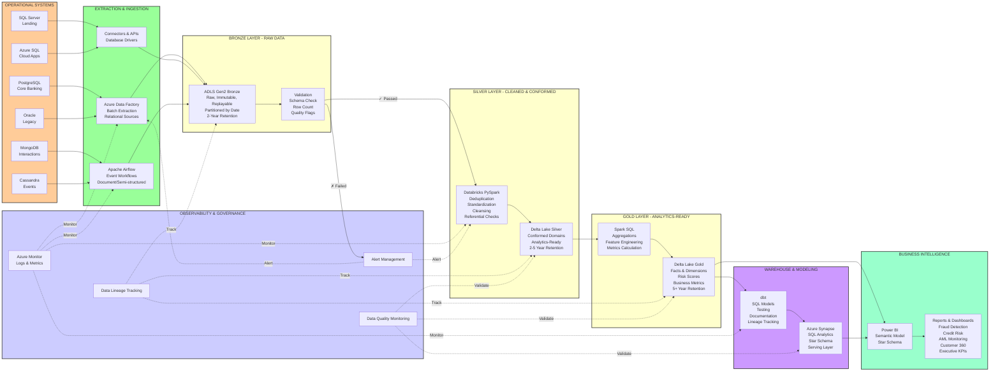

# SOLUTION ARCHITECTURE
## End-to-End Data Flow & Technology Integration

**Document Version:** 1.0  
**Date:** 2026-09-01  
**Audience:** Solutions Architects, Tech Leads, Senior Engineers

---

## END-TO-END DESIGN

### Design Philosophy

ADF performs metadata-driven, scheduled extraction from PostgreSQL, Oracle, SQL Server, and Azure SQL into immutable ADLS landing/Bronze paths. Airflow is reserved for code-defined orchestration of Cassandra/MongoDB/event and quality workflows; it may trigger a Databricks job but is not a second scheduler for ADF copies.

Databricks uses PySpark and Delta Lake for ETL from Bronze to Silver: schema checks, standardisation, deduplication, referential checks, and quarantine. It uses ELT-style transformations inside Delta/Synapse for Gold aggregates and dimensional marts. dbt owns serving-layer SQL models, tests, documentation, and lineage; Synapse provides SQL-accessible curated marts. Power BI consumes Gold or Synapse star schemas.

### Processing Pipeline

| Stage | Pattern | Owner | Output | Duration |
| --- | --- | --- | --- | --- |
| Extract/land | ETL movement, minimal transformation | ADF / Airflow | Raw encrypted files + audit trail | 2 hours |
| Bronze→Silver | ETL cleansing and conformance | Databricks | Validated Delta tables + quarantine | 1 hour |
| Silver→Gold | ELT analytics transformations | Databricks + dbt | Facts, dimensions, features, alerts | 1.5 hours |
| Serve | SQL models and mart creation | dbt/Synapse | Governed star schemas and views | 30 min |

### Complete Data Flow Diagram



---

## DETAILED PIPELINE STAGES

### Stage 1: Extraction & Ingestion (2 Hours)

**Responsibility:** Azure Data Factory + Apache Airflow

**For Relational Sources (PostgreSQL, Oracle, SQL Server, Azure SQL):**
- ADF performs metadata-driven extraction
- Daily schedule @ 00:00 UTC
- Incremental extraction using high water marks
- Data encrypted during transit
- Error handling: Retry 3x before alerting

**For Document & Event Sources (MongoDB, Cassandra):**
- Airflow orchestrates extraction
- Custom Python operators handle semi-structured data
- MongoDB: JSON export to Parquet
- Cassandra: Event stream micro-batches
- Quality checks at landing

**Output:** Raw files in ADLS Bronze zone with audit metadata

---

### Stage 2: Validation (Continuous)

**Responsibility:** Data Quality Framework

**Checks Applied:**
- Schema matches expected format ✓
- Row count reconciliation ✓
- No unexpected nulls in key columns ✓
- Data type validation ✓
- Freshness verification ✓

**On Failure:**
- Data quarantined (marked as FAILED_QC)
- Alert sent to operations
- Retry attempted next cycle
- Root cause logged for investigation

---

### Stage 3: Bronze → Silver (1 Hour)

**Responsibility:** Databricks + PySpark

**Transformations:**
1. **Deduplication:** Remove duplicate records by business key
2. **Standardization:** Normalize formats (dates, phone, email)
3. **Null Handling:** Apply domain-specific null policies
4. **Referential Integrity:** Validate foreign keys
5. **Type Casting:** Ensure correct data types
6. **Cleansing:** Remove known data quality issues

**Technology:** PySpark on Databricks  
**Output:** Clean, conformed Delta Lake tables in Silver zone

**Example - Customer Deduplication:**
```python
customers_clean = (bronze_customers
  .dropDuplicates(['customer_id', 'country_code'])
  .withColumn('source_priority', 
    when(col('source') == 'core_banking', 1)
      .when(col('source') == 'digital', 2)
      .otherwise(3))
  .sort_values('source_priority')
  .drop_duplicates('customer_id')
)
```

---

### Stage 4: Silver → Gold (1.5 Hours)

**Responsibility:** Databricks + Spark SQL

**Transformations:**
1. **Aggregation:** Roll up transactions by day/merchant
2. **Enrichment:** Add customer 360 attributes
3. **Feature Engineering:** Calculate risk scores, metrics
4. **Business Logic:** Apply domain rules
5. **Metrics:** Derive KPIs and measures
6. **Snapshots:** Create point-in-time dimensions

**Technology:** Spark SQL on Databricks  
**Output:** Business-aligned datasets in Gold zone

**Example - Fraud Score Calculation:**
```sql
CREATE TABLE fact_fraud_scores_daily AS
SELECT 
  transaction_id,
  account_id,
  customer_id,
  transaction_date,
  amount,
  -- Amount anomaly
  CASE 
    WHEN amount > percentile_cont(0.95) OVER (PARTITION BY customer_id) 
      THEN 0.4
    ELSE 0.1
  END as amount_risk,
  
  -- Frequency anomaly
  CASE 
    WHEN COUNT(*) OVER (PARTITION BY customer_id, DATE_TRUNC('day', transaction_timestamp)) > 100
      THEN 0.3
    ELSE 0.05
  END as frequency_risk,
  
  -- Location change
  CASE 
    WHEN merchant_country != customer_primary_country
      THEN 0.2
    ELSE 0
  END as location_risk,
  
  -- Combined score
  (amount_risk + frequency_risk + location_risk) as fraud_risk_score
FROM silver.transactions
```

---

### Stage 5: Modeling & Serving (30 Minutes)

**Responsibility:** dbt + Azure Synapse

**dbt Models:**
- Fact tables (transactions, fraud scores, credit scores)
- Dimension tables (customers, accounts, merchants, time)
- Slowly Changing Dimensions (SCD Type 2 for history)
- Derived metrics and aggregations
- Data validation tests

**Technology:** SQL on Synapse  
**Output:** Governed star schema ready for BI

**Example dbt Model:**
```sql
-- models/mart/fact_transactions.sql
{{
  config(
    materialized='table',
    tags=['critical', 'daily']
  )
}}

WITH transactions AS (
  SELECT * FROM {{ ref('stg_transactions') }}
),
customers AS (
  SELECT * FROM {{ ref('dim_customers') }}
),
accounts AS (
  SELECT * FROM {{ ref('dim_accounts') }}
)
SELECT 
  {{ dbt_utils.surrogate_key(['transaction_id', 'transaction_date']) }} as transaction_key,
  t.transaction_id,
  t.account_id,
  t.customer_id,
  c.customer_key,
  a.account_key,
  DATE(t.transaction_timestamp) as transaction_date,
  t.amount,
  t.status,
  CURRENT_TIMESTAMP() as load_timestamp
FROM transactions t
INNER JOIN customers c ON t.customer_id = c.customer_id
INNER JOIN accounts a ON t.account_id = a.account_id
WHERE t.transaction_date >= DATE_SUB(CURRENT_DATE(), 90)
```

---

### Stage 6: Business Intelligence (Continuous)

**Responsibility:** Power BI + Analytics Team

**Semantic Model:**
- Star schema with facts and dimensions
- DAX measures and calculated columns
- Row-level security policies
- Automatic refresh schedule

**Dashboards:**
1. **Daily Fraud Monitoring** - Real-time fraud detection
2. **Credit Risk Portfolio** - Risk distribution and trends
3. **AML Transaction Monitoring** - Suspicious activity
4. **Customer 360** - Customer analytics
5. **Executive KPIs** - Business performance

---

## TECHNOLOGY RESPONSIBILITY ASSIGNMENT

### Azure Data Factory (ADF)

**Responsibilities:**
- Extract from relational source systems (PostgreSQL, Oracle, SQL Server, Azure SQL)
- Schedule daily batch extractions
- Validate schema on extraction
- Monitor extraction performance
- Handle encryption in transit

**When to Use:**
- Relational source extraction
- Simple cloud-to-cloud data movement
- Native Azure integration required

**When NOT to Use:**
- Complex multi-step workflows
- Custom logic and transformations
- Non-relational sources (MongoDB, Cassandra)

---

### Apache Airflow

**Responsibilities:**
- Orchestrate Cassandra event extraction
- Orchestrate MongoDB document export
- Trigger Databricks jobs
- Manage complex multi-step workflows
- Handle error recovery and retries
- Execute quality validation tasks

**When to Use:**
- Complex workflows with dependencies
- Event and document source extraction
- Custom Python logic
- External system integration
- Testing and scheduling scenarios

**When NOT to Use:**
- Simple cloud-to-cloud extractions (use ADF)
- Already-mature managed services (use native tools)

---

### Azure Databricks

**Responsibilities:**
- Execute Bronze → Silver transformations
- Execute Silver → Gold transformations
- Feature engineering and metric calculation
- Data quality validation
- Incremental processing
- Schema management

**When to Use:**
- Distributed data processing
- PySpark transformations
- Complex business logic
- Data quality checks
- Feature engineering

---

### Azure Synapse Analytics

**Responsibilities:**
- Host analytical data warehouse
- Serve star schema for BI tools
- Execute dbt SQL models
- Provide SQL endpoint for ad-hoc queries
- Support row-level security

**When to Use:**
- Enterprise data warehouse
- SQL-based analytics
- Star schema serving
- Complex SQL analytics

---

### dbt (Data Build Tool)

**Responsibilities:**
- Define SQL transformation models
- Test data quality
- Document transformations
- Track data lineage
- Manage version control
- Generate documentation

**When to Use:**
- SQL transformation modeling
- Data testing and validation
- Documentation requirements
- Lineage tracking
- Version-controlled data pipeline

---

### Power BI

**Responsibilities:**
- Create semantic models
- Build reports and dashboards
- Visualize analytics
- Enable self-service analytics
- Manage access control

**When to Use:**
- Business intelligence
- User reporting
- Executive dashboards
- Self-service analytics

---

## BATCH VS. NEAR-REAL-TIME STRATEGY

### MVP Approach: Batch Processing

**Default Processing Mode:** Micro-batch (daily)

**Rationale:**
- Simplicity for portfolio project
- Easier to test and debug
- Lower infrastructure costs
- Sufficient for most banking analytics

**Processing Schedule:**
- Daily @ 00:00 UTC: Full extraction
- Databricks: 02:00-03:00 UTC: Silver transformations
- Databricks: 04:00-05:00 UTC: Gold transformations
- Synapse: 05:30-06:00 UTC: Warehouse refresh
- Power BI: 06:30 UTC: Dashboard refresh

**Throughput:** ~10-50M transactions/day

---

### Production Extension: Near-Real-Time (Phase 2+)

**When Real-Time Required:**
- Fraud detection needs sub-minute latency
- Risk scoring requires immediate updates
- Compliance monitoring needs immediate alerts

**Approach (Future):**
- Cassandra event stream → Apache Kafka
- Kafka → Spark Structured Streaming
- Streaming transformations → Gold Delta tables
- Incremental updates to Synapse

**Trade-off:** Increased complexity, cost, and operational burden

---

## KEY ARCHITECTURAL DECISIONS

### Decision 1: ELT over ETL

**Choice:** Load data raw, transform after  
**Rationale:**
- Preserve raw data for audit and recovery
- Distribute heavy lifting to Databricks
- Enable exploratory analysis
- Decouple ingestion from transformation

### Decision 2: Delta Lake for Storage

**Choice:** Parquet + Delta Lake format  
**Rationale:**
- ACID compliance
- Schema enforcement
- Time travel for recovery
- Incremental processing support

### Decision 3: Star Schema for Analytics

**Choice:** Fact + dimension tables  
**Rationale:**
- Simple for business users
- Fast analytical queries
- Clear measures and dimensions
- Standard in data warehousing

### Decision 4: Daily Batch Processing

**Choice:** Micro-batch over streaming  
**Rationale:**
- MVP simplicity
- Lower cost
- Sufficient for most use cases
- Can upgrade to streaming later

---

## PERFORMANCE & SLA TARGETS

| Metric | Target | Status |
|--------|--------|--------|
| Extraction duration | < 2 hours | MVP |
| Bronze validation | < 15 min | MVP |
| Silver transformation | < 1 hour | MVP |
| Gold transformation | < 1.5 hours | MVP |
| Warehouse load | < 30 min | MVP |
| BI refresh | < 30 min | MVP |
| Total pipeline | < 6 hours | MVP |
| Report availability | 99% | MVP |
| Query latency | < 30 sec | MVP |

---

**Related Documents:**
- [Logical Architecture](3-logical-architecture.md)
- [Infrastructure Architecture](4-infrastructure-architecture.md)
- [Data Architecture](5-data-architecture.md)
- [Orchestration Strategy](#orchestration-strategy)

---

**Date:** 2026-09-01  
**Status:** Ready for Review
