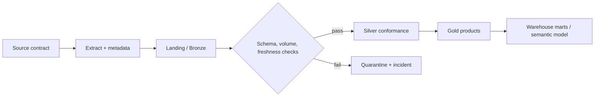

# Logical architecture

## Ingestion and integration

Sources publish versioned extracts/events with source system, extraction timestamp, batch ID, and business key. ADF handles connector-rich relational copy, retries, and schedules. Airflow handles Python-first MongoDB/Cassandra/event workflows, dependency logic, and demonstration DAGs. Both write a common ingestion audit; neither transforms business meaning in transit.

## Lakehouse and processing

Bronze is append-only raw evidence. Silver has standard types, common customer/account identifiers, masked analytical fields, and data-quality status. Gold contains use-case products. Delta provides ACID writes, time travel, schema enforcement, and incremental merge. Partition transaction/event data by business date (and only high-cardinality keys where justified); use checkpointing and idempotent batch IDs.

## Warehouse and analytics

Synapse/dbt model `fact_transaction`, `fact_loan_snapshot`, `fact_repayment`, `fact_fraud_event`, `fact_aml_alert`, and `fact_customer_interaction` with `dim_customer`, `dim_account`, `dim_card`, `dim_merchant`, `dim_branch`, and `dim_date`. Customer and branch dimensions are SCD Type 2 where history changes analytical interpretation. Power BI owns measures, certified semantic models, RLS roles, and dashboards; Python visuals are limited to approved statistical/segmentation analysis, while DAX remains preferred for governed KPIs.

## Use-case products

| Product | Gold dataset | Core metrics |
| --- | --- | --- |
| Fraud risk | `gold_fraud_transaction_score` | alert rate, false-positive review rate, amount at risk |
| Credit risk | `gold_credit_portfolio_snapshot` | delinquency, exposure, repayment rate |
| AML | `gold_aml_case_candidate` | threshold breaches, alert disposition, investigation age |
| Customer 360 | `gold_customer_360` | active products, interaction recency, value segment |
| Executive | `gold_executive_daily` | deposits, loans, transaction volume, branch performance |

Mermaid/draw.io logical diagrams for data, integration, Databricks, ETL/ELT, Power BI, lineage, governance, security, and use cases are indexed in [`docs/diagrams/README.md`](../diagrams/README.md).
