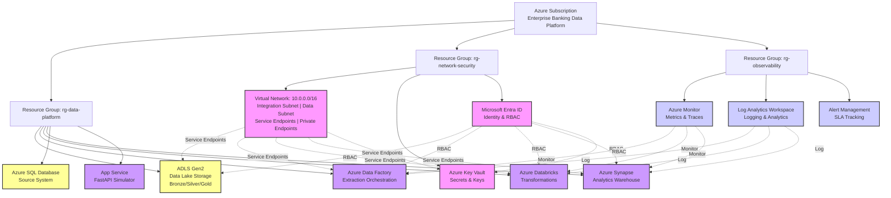

# TECHNICAL INFRASTRUCTURE ARCHITECTURE
## Azure Platform & Network Design

**Document Version:** 1.0  
**Date:** 2026-09-01  
**Audience:** Infrastructure Engineers, DevOps, Cloud Architects

---

## AZURE SUBSCRIPTION & RESOURCE ORGANIZATION

### Subscription Structure (MVP)

```
Azure Subscription: "Enterprise Banking Data Platform"
├── Resource Group: "rg-data-platform-dev"
│   ├── Region: East US (or user preference)
│   └── Purpose: Development and testing
│
├── Resource Group: "rg-network-security"
│   └── Purpose: Virtual networking, Key Vault
│
└── Resource Group: "rg-observability"
    └── Purpose: Monitoring and logging
```

**Design Decision:** Single subscription for MVP (portfolio project)  
**Production Extension:** Multiple subscriptions (dev/test/prod segregation)

### Azure Topology Diagram



---

## CORE AZURE SERVICES

### 1. Azure Data Lake Storage Gen2 (ADLS Gen2)

**Purpose:** Cloud data lake for Bronze/Silver/Gold zones  
**SKU:** Standard | Hot Tier (MVP)  
**Replication:** Locally Redundant (LRS)  
**Encryption:** Enabled (Microsoft-managed keys MVP; CMK production)

**Configuration:**
```
Storage Account: "stadplatform{env}eus"
├── Containers:
│   ├── /bronze/ (Immutable, raw data)
│   ├── /silver/ (Cleaned/standardized)
│   ├── /gold/ (Analytics-ready)
│   └── /artifacts/ (Code, metadata, logs)
│
├── Partitioning:
│   /bronze/postgresql/customers/year=2024/month=09/day=01/data.parquet
│   /silver/customers/year=2024/month=09/day=01/data.parquet
│   /gold/dim_customers/year=2024/month=09/day=01/data.parquet
│
├── Access Control:
│   ├── Storage Blob Data Contributor (ADF MI)
│   ├── Storage Blob Data Reader (BI MI)
│   └── Firewall: Allow VNet service endpoint
│
└── Lifecycle Management:
    ├── Move to Cool after 30 days
    └── Delete after 2 years (MVP)
```

**Cost Optimization:**
- Standard tier (not Premium)
- Locally redundant (LRS not GRS MVP)
- Lifecycle policies for archival
- Parquet format + snappy compression

---

### 2. Azure Databricks

**Purpose:** Distributed compute for transformations  
**Tier:** Premium (required for Unity Catalog and enterprise features)  
**Deployment:** Single workspace

**Workspace Configuration:**
```
Workspace: "dbw-platform-{env}-eus"
├── All-purpose Cluster (Interactive Development):
│   ├── Databricks Runtime: 15.4 LTS
│   ├── Driver: i3.xlarge (4 cores, 30GB memory)
│   ├── Workers: 2-4 (auto-scaling)
│   └── Spot Instances: Enabled (save 70%)
│
├── Job Cluster (Scheduled ETL):
│   ├── Runtime: 15.4 LTS
│   ├── Driver: i3.xlarge
│   ├── Workers: 4-8
│   ├── Auto-terminate: 10 min idle
│   └── Provisioning: On-demand
│
└── Compute Policy: Standard (limit usage)
```

**Notebooks:**
```
Workspace Structure:
├── /Shared/etl/ (Bronze → Silver transformations)
├── /Shared/analytics/ (Silver → Gold transformations)
├── /Users/data_engineer/ (Personal exploration)
└── /Repos/enterprise-banking/ (Git integration)
```

**Cost Optimization:**
- Use job clusters (auto-terminate)
- Enable auto-scaling (min 2, max 8 workers)
- Use spot instances (additional 30% discount)
- Develop with all-purpose cluster (cheaper than jobs)

---

### 3. Azure Synapse Analytics

**Purpose:** Data warehouse and analytics serving layer  
**Type:** Dedicated SQL Pool  
**Performance Level:** DW300c (MVP) → DW500c (production)

**Workspace Configuration:**
```
Synapse Workspace: "syn-platform-{env}-eus"
├── Dedicated SQL Pool: "sqldw"
│   ├── Performance Level: DW300c (300 DWU units)
│   ├── Collation: SQL_Latin1_General_CP1_CI_AS
│   ├── Backup: 7-day retention
│   ├── Pause: Enabled (cost saving when not used)
│   └── Auto-pause: 15 min idle
│
├── Serverless SQL Pool: "Built-in"
│   └── For ad-hoc queries on Gold/Silver zones (pay per query)
│
├── Apache Spark Pool: "sparkpool" (Optional)
│   ├── Node Size: Small (4 cores, 32GB RAM)
│   ├── Min Nodes: 3 (Autoscale enabled)
│   └── Session Timeout: 30 min
│
└── Integration Runtime:
    ├── Azure Integration Runtime (default)
    └── Self-hosted IR: Not needed (MVP)
```

**Database Schema:**
```
Database: "warehouse"
├── Schema: "raw" (Bronze/Silver data views)
├── Schema: "staging" (Intermediate tables)
├── Schema: "mart" (Star schema facts/dimensions)
└── Schema: "archive" (Historical data)
```

**Cost Optimization:**
- Use serverless SQL for ad-hoc queries
- Pause pool when not in use (nights, weekends)
- MVP estimated cost: $100-200/month (paused)
- Scale up only during peak analysis hours

---

### 4. Azure Data Factory (ADF)

**Purpose:** Orchestrate relational data extraction  
**Tier:** Standard  
**Cost Model:** Pay per activity (free tier for < 1M activities/month)

**Factory Configuration:**
```
Data Factory: "adf-platform-{env}-eus"
├── Linked Services:
│   ├── PostgreSQL (Dynamic JDBC, managed identity)
│   ├── Oracle (ODP.NET connection)
│   ├── SQL Server (OLEDB connection)
│   ├── Azure SQL (Native Azure connector)
│   ├── ADLS Gen2 (Managed identity)
│   └── Key Vault (for secrets)
│
├── Integration Runtime:
│   └── Azure IR (no self-hosted needed MVP)
│
├── Datasets (15 total):
│   ├── PostgreSQL: customers, accounts, transactions
│   ├── Oracle: gl_ledger, audit_trail
│   ├── SQL Server: loans, repayments, branches
│   ├── Azure SQL: users, sessions
│   └── ADLS: Bronze containers
│
└── Pipelines (8 total):
    ├── extract_postgresql (Daily @ 00:00 UTC)
    ├── extract_oracle (Daily @ 00:30 UTC)
    ├── extract_sqlserver (Daily @ 01:00 UTC)
    ├── extract_azuresql (Daily @ 01:30 UTC)
    ├── validate_bronze (Daily @ 02:00 UTC)
    ├── error_handling (On failure)
    ├── monitor_pipeline (Track metrics)
    └── cleanup_logs (Retention policy)
```

**Error Handling:**
```python
# Retry policy for each copy activity:
Retry Count: 3
Retry Interval: 5 minutes
Backoff Multiplier: 1.5x

# On All Retries Failed:
Send Alert → Operations Team
Preserve Error Artifact → Investigation
Mark Pipeline as FAILED
```

---

### 5. Apache Airflow (Hosted)

**Purpose:** Orchestrate complex workflows, event sources  
**Deployment Option:** Azure Container Instances (lightweight) + Postgres backend

**Container Configuration:**
```
Container Group: "airflow-container-group"
├── Image: apache/airflow:2.10-python3.11
├── Instances:
│   ├── Webserver (port 8080)
│   ├── Scheduler
│   └── Worker (for task execution)
│
├── Environment Variables:
│   ├── AIRFLOW__CORE__LOAD_EXAMPLES: False
│   ├── AIRFLOW__DATABASE__SQL_ALCHEMY_CONN: PostgreSQL URI
│   ├── AIRFLOW__WEBSERVER__SECRET_KEY: (From Key Vault)
│   ├── AIRFLOW__CORE__DAGS_FOLDER: /opt/airflow/dags
│   └── Azure Credentials (via MI)
│
├── Resources:
│   ├── CPU: 2 cores
│   ├── Memory: 4 GB
│   └── Port: 8080 (UI), 5555 (monitoring)
│
└── Restart Policy: Always
```

**Database Backend:**
```
Service: Azure Database for PostgreSQL (Flexible Server)
├── SKU: Burstable B1MS (affordable MVP)
├── Storage: 32 GB
├── Backup: 7-day retention
└── Connection Pooling: PgBouncer enabled
```

**DAG Storage:**
```
GitHub Repository: /airflow/dags/
├── daily_banking_etl.py (Main orchestration)
├── operators/
│   ├── mongodb_extract.py
│   ├── cassandra_extract.py
│   └── quality_validation.py
├── config/
│   └── airflow.cfg
└── requirements.txt (Python dependencies)
```

---

### 6. Azure Key Vault

**Purpose:** Centralized secrets and encryption key management  
**Tier:** Standard  
**Access Method:** RBAC + Managed Identities

**Secrets (Stored):**
```
Key Vault: "kv-platform-{env}-eus"
├── Database Connection Strings:
│   ├── postgresql-conn-str
│   ├── oracle-conn-str
│   ├── sqlserver-conn-str
│   ├── azuresql-conn-str
│   ├── mongodb-conn-str
│   └── cassandra-conn-str
│
├── Service Account Credentials:
│   ├── databricks-token
│   ├── powerbi-service-principal-pwd
│   ├── airflow-webserver-secret-key
│   └── adf-service-principal-pwd
│
├── API Keys:
│   ├── powerbi-api-key
│   └── external-api-keys
│
└── Encryption Keys:
    ├── adls-cmk (Customer-managed key)
    └── database-tde-key
```

**Access Policy (Least Privilege):**
```
ADF Managed Identity:
  ├── Get secrets: ✓
  └── List keys: ✗

Databricks Managed Identity:
  ├── Get secrets: ✓
  └── Get certificates: ✗

Operations Team (Entra Group):
  ├── Get/List/Set/Delete: ✓
  └── All key operations: ✓
```

**Security:**
- ✓ Secrets never committed to Git
- ✓ Rotation policy: Every 90 days
- ✓ Audit logging: All access tracked
- ✓ Soft delete: 90-day recovery window

---

### 7. Microsoft Entra ID

**Purpose:** Identity, authentication, and authorization  
**Directory:** Azure AD tenant (`{company}.onmicrosoft.com`)

**Organization Structure:**
```
Users & Groups:
├── Group: DataEngineers
│   ├── Alice (Senior)
│   ├── Bob (Mid-level)
│   └── Carla (Junior)
│
├── Group: AnalyticsTeam
│   ├── Diana (Senior Analyst)
│   ├── Evan (Analyst)
│   └── Fiona (Analyst)
│
├── Group: BITeam
│   └── Grace (BI Developer)
│
└── Group: Operations
    ├── Henry (DevOps)
    └── Iris (DBA)

Service Principals (Workload Identities):
├── adf-managed-identity (for ADF pipelines)
├── databricks-managed-identity (for Databricks jobs)
├── synapse-managed-identity (for Synapse access)
├── powerbi-service-principal (for BI refresh)
└── airflow-service-principal (for Airflow execution)
```

**Enterprise Applications (SSO):**
```
├── Databricks (SAML-based)
├── Power BI (OAuth 2.0)
├── Synapse (Integrated Azure AD)
└── Azure Portal (Default)
```

**RBAC Role Assignments:**
```
DataEngineers Group:
├── Storage Blob Data Contributor (ADLS)
├── Databricks Admin (Workspace)
├── Synapse SQL Admin
└── Key Vault Secrets Officer

AnalyticsTeam Group:
├── Storage Blob Data Reader (ADLS Gold)
├── Databricks User (Workspace)
├── Synapse Reader (SQL Pool)
└── Power BI Report Viewer

BITeam Group:
├── Storage Blob Data Reader (ADLS Gold)
└── Power BI Premium Admin

Operations Group:
├── Reader (All resources)
├── Monitoring Contributor
└── Key Vault Admin
```

---

### 8. Azure Monitor & Log Analytics

**Purpose:** Centralized observability and monitoring  
**Components:**
```
Log Analytics Workspace: "law-platform-{env}-eus"
├── Retention: 30 days (free tier)
├── Pricing Tier: Pay-as-you-go
├── Query Language: KQL (Kusto Query Language)
└── Workspace Region: East US

Diagnostic Settings Configured:
├── ADF: Send logs to LAW
├── Databricks: Send logs to LAW
├── Synapse: Send logs to LAW
├── App Service: Send metrics to LAW
└── Key Vault: Audit logs to LAW

Metrics Collected:
├── Pipeline execution time
├── Records processed / errors
├── Databricks job status
├── Synapse query performance
├── Storage access patterns
└── Security events
```

**Dashboards Created:**
```
Dashboard 1: Pipeline Execution
├── ADF pipeline runs (success %)
├── Databricks job status
├── Airflow DAG execution
└── Average duration by pipeline

Dashboard 2: Data Quality
├── Record counts by zone
├── Null percentages
├── Duplicate detection
└── Schema validation failures

Dashboard 3: Cost Tracking
├── Daily spend by resource
├── Compute hours used
├── Storage utilization
└── Cost trend analysis

Dashboard 4: Security & Compliance
├── Data access events
├── Failed authentication attempts
├── Key Vault access
└── Audit log entries
```

**Alerts Configured:**
```
Alert Rule: Pipeline Failure
├── Condition: Any ADF pipeline FAILED
├── Severity: High
├── Action: Email operations team + Slack

Alert Rule: Data Quality Deviation
├── Condition: Null % > 5% OR duplicate % > 2%
├── Severity: Medium
└── Action: Email data team

Alert Rule: Daily Spend Threshold
├── Condition: Daily cost > $50
├── Severity: Medium
└── Action: Email finance team

Alert Rule: SLA Breach
├── Condition: Pipeline duration > 6 hours
├── Severity: High
└── Action: Page on-call engineer
```

---

### 9. Virtual Networking

**Network Design:**
```
Virtual Network: "vnet-platform-eus"
├── Address Space: 10.0.0.0/16
│
├── Subnet 1: "subnet-databricks-pub" (10.0.1.0/24)
│   ├── Purpose: Databricks public clusters
│   ├── Service Endpoints: ADLS, Synapse
│   └── NSG: Allow HTTPS outbound to Azure services
│
├── Subnet 2: "subnet-integration" (10.0.2.0/24)
│   ├── Purpose: ADF IR, Airflow container
│   ├── Service Endpoints: ADLS, Key Vault
│   └── NSG: Allow outbound to databases
│
├── Subnet 3: "subnet-appservice" (10.0.3.0/24)
│   ├── Purpose: App Service (FastAPI simulator)
│   ├── Service Endpoints: ADLS
│   └── NSG: Allow HTTP/HTTPS
│
└── Subnet 4: "subnet-data-priv" (10.0.4.0/24)
    ├── Purpose: Private endpoints (future)
    └── Private Link: ADLS, Synapse, Key Vault
```

**Network Security Groups (NSG):**
```
NSG: databricks-nsg
├── Inbound Rules:
│   ├── Allow SSH (22) from corp network
│   ├── Allow HTTPS (443) from subnet-integration
│   └── Deny all other
│
└── Outbound Rules:
    ├── Allow HTTPS (443) to Azure services
    ├── Allow DNS (53) to internet
    └── Deny all other

NSG: integration-nsg
├── Inbound Rules: Deny all (not internet-facing)
│
└── Outbound Rules:
    ├── Allow connections to databases (5432, 1521, 1433)
    ├── Allow HTTPS (443) to Azure services
    └── Allow DNS (53)
```

---

## SECURITY HARDENING

### Encryption Strategy

**At Rest:**
```
✓ ADLS Gen2:
  - SSE-S (Server-Side Encryption - Storage)
  - Optional: Customer-Managed Key (CMK)

✓ Synapse:
  - TDE (Transparent Data Encryption)
  - Optional: BYOK (Bring Your Own Key)

✓ Key Vault:
  - FIPS 140-2 Level 2 (Standard)
  - Optional: Level 3 (Premium)

✓ Databases:
  - Azure SQL: TDE by default
  - PostgreSQL: All encryption options available
```

**In Transit:**
```
✓ HTTPS/TLS 1.2+ for all connections
✓ VNet Service Endpoints (avoid internet routing)
✓ Private Endpoints (production extension)
✓ SQL Encryption: ALWAYS ENCRYPTED optional
```

---

## COST OPTIMIZATION STRATEGY

### Estimated Monthly Costs (MVP)

| Service | Configuration | Cost |
|---------|---|---|
| ADLS Gen2 | 100GB standard | $5 |
| Databricks | 4 node-hours/day @ $0.25/hour | $300 |
| Synapse DW300c | Paused except reports (8h/day) | $150 |
| Data Factory | ~500 activities | $10-20 |
| Airflow (Container) | 2-4 GB memory, always on | $50-100 |
| PostgreSQL | Flexible Server B1MS | $20-30 |
| Key Vault | ~5K operations | $1 |
| Monitor/Logging | ~500MB ingestion | $20-30 |
| **Total** | | **$550-650/month** |

### Cost Control Measures

1. **Compute:**
   - Stop Synapse DW when not in use (pause during off-hours)
   - Use auto-scaling for Databricks (2-8 workers)
   - Use spot instances (70% discount on worker nodes)
   - Schedule Airflow container for business hours only

2. **Storage:**
   - Implement lifecycle policies (move to cool tier after 30 days)
   - Compress data (Parquet + snappy reduces size 50%)
   - Partition by date (enables pruning, faster queries)
   - Delete old Bronze data after 2 years

3. **Monitoring:**
   - Set daily budget alerts ($25/day = $750/month)
   - Review Azure Cost Management weekly
   - Tag all resources for cost tracking
   - Use reserved instances (production extension)

4. **Development:**
   - Reuse shared dev environment (don't clone subscriptions)
   - Stop resources during lunch and after work hours
   - Use smaller Databricks clusters for development
   - Destroy ephemeral resources immediately

---

## DISASTER RECOVERY STRATEGY

### Backup & Recovery

| Component | Backup Method | Retention | RTO | RPO |
|---|---|---|---|---|
| ADLS Gen2 | GRS + snapshots | 30 days | 4h | 24h |
| Databases | Automated backups | 7-35 days | 2h | 1h |
| Synapse | Snapshot backups | 7 days | 4h | 24h |
| Databricks | Delta time travel | 30 days | 1h | Minutes |
| dbt models | Git versioning | Unlimited | 15min | Minutes |
| Config/Code | GitHub + CI/CD | Unlimited | 15min | Commit |

### Recovery Procedures

**Data Lake Recovery:**
1. Identify affected table/date range
2. Use Delta Lake time travel feature
3. Restore to previous version
4. Re-run downstream jobs if needed

**Database Recovery:**
1. Identify failure point
2. Use point-in-time restore
3. Validate data integrity
4. Switch connection strings

**Full Disaster:**
1. Recreate infrastructure via Terraform
2. Restore databases from backup
3. Re-run Databricks transformation notebooks
4. Refresh Power BI semantic models

---

**Date:** 2026-09-01  
**Status:** Ready for Review

**Related Documents:**
- [Data Architecture](5-data-architecture.md)
- [Security Architecture](6-security-architecture.md)
- [Operations Runbook](../operations/runbook.md)

Power BI Service is a SaaS consumer; an on-premises gateway is unnecessary for cloud sources but may be required for privately hosted source-system simulation.
