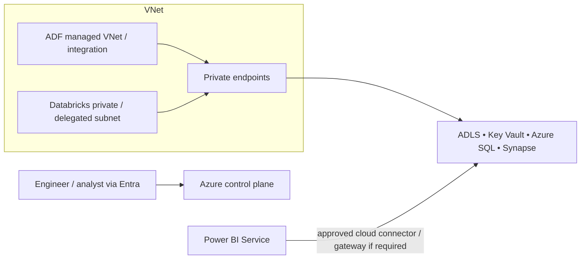

# Network architecture

The portfolio implementation keeps the topology small: managed Azure services live in one region; VNet integration/private endpoints protect data-plane access; public ingress is disabled or restricted where supported. Developer access uses Entra authentication, never exposed database credentials.

Production adds private DNS, firewall policy, egress control, split development/test/production subscriptions, and connectivity to on-premises sources.
