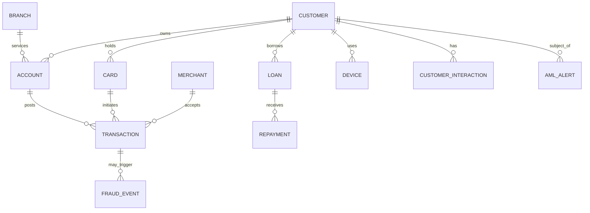

# Conceptual data model

Customer is the party master. Accounts hold balances and post transactions. Cards instrument account payments; merchants receive them. Loans and repayments model credit. Devices/interactions contribute digital context. Fraud events relate to transactions; AML alerts relate to customers and may cite many transactions through an alert-evidence bridge in the physical model.
